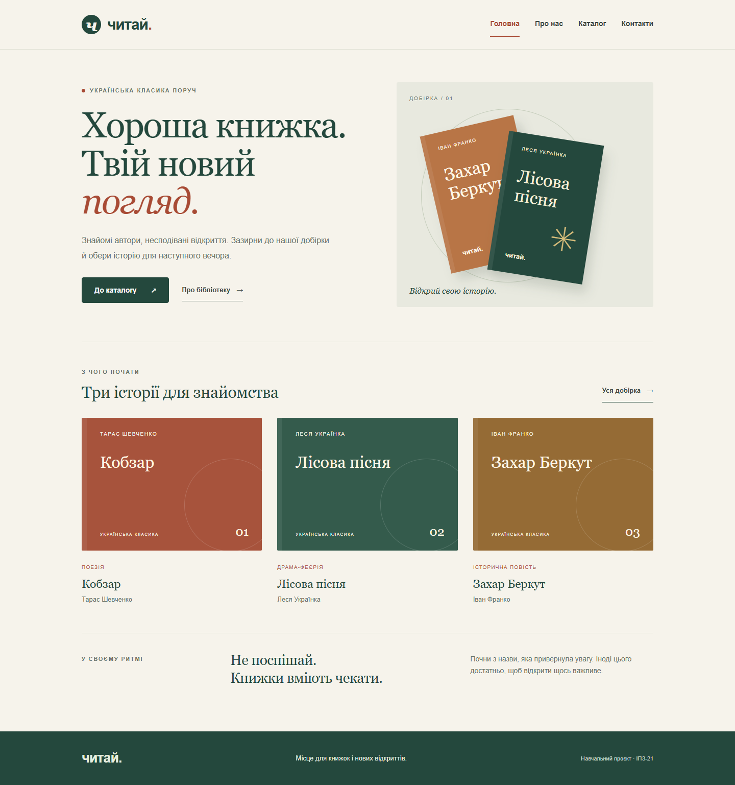
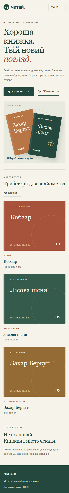
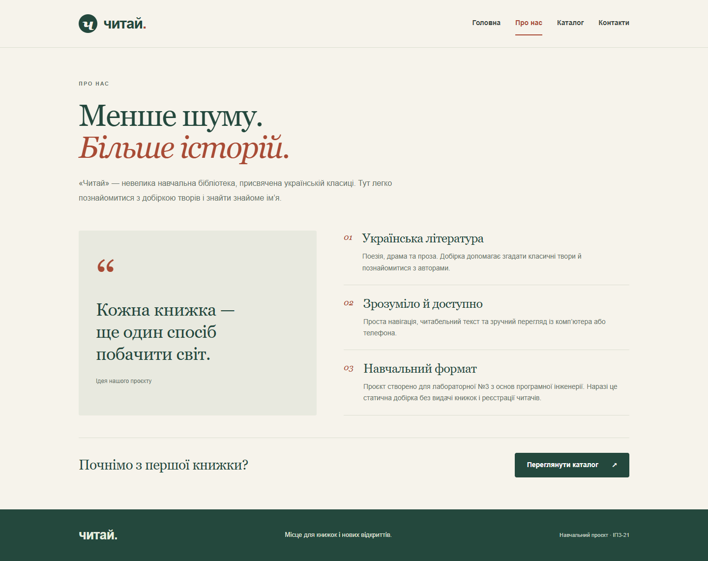
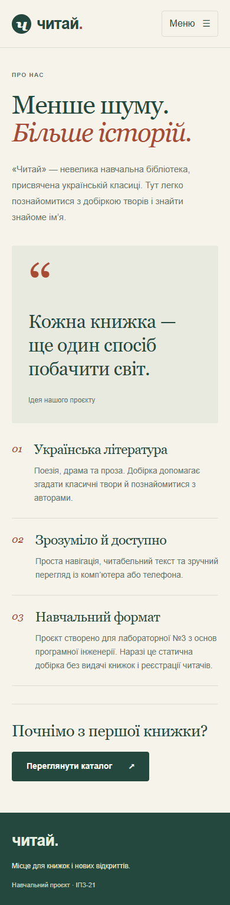
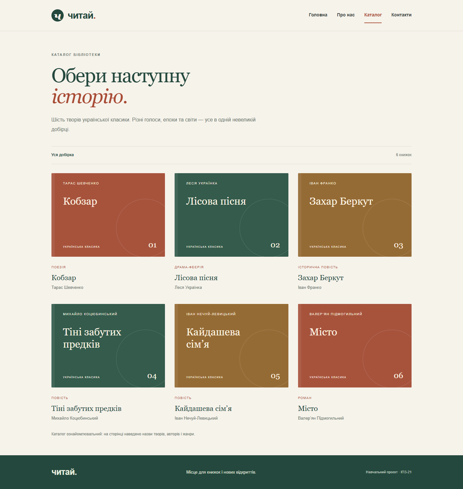
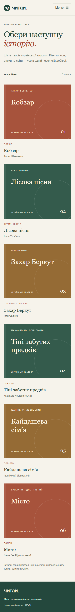
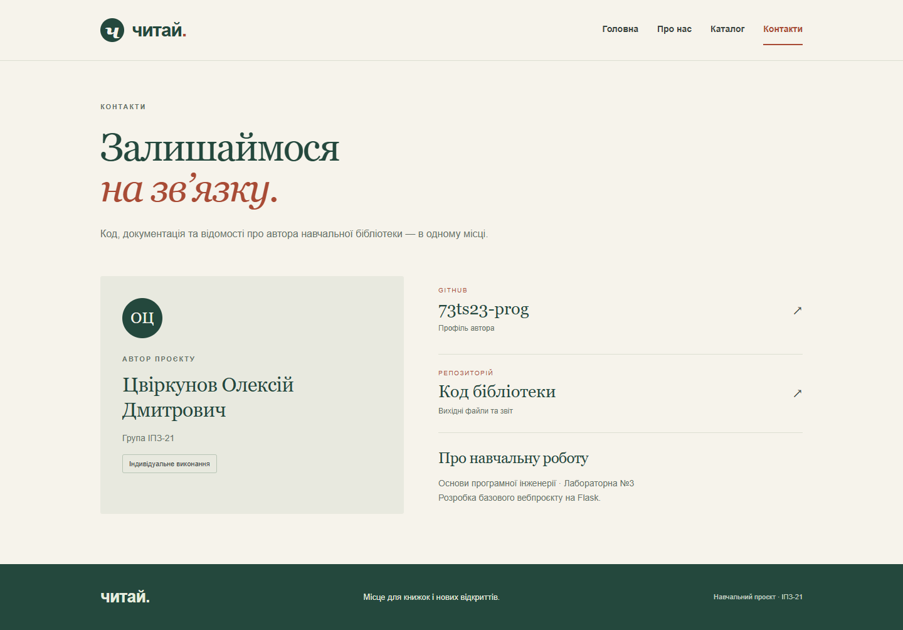
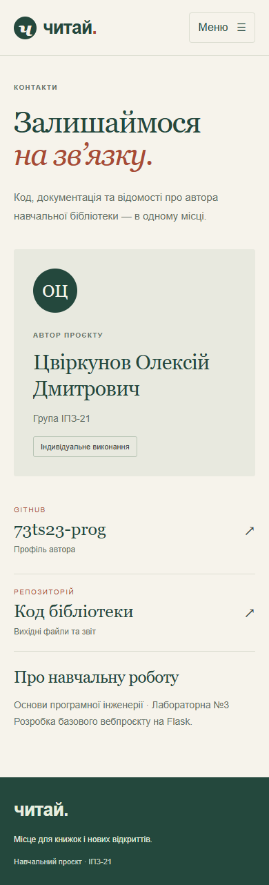

# Лабораторна робота №3

**Тема:** Розробка базового вебпроєкту.

**Виконав:** Цвіркунов Олексій Дмитрович.

**Група:** ІПЗ-21.

**Предметна область:** навчальна бібліотека української літератури «Читай».

**Виконані технічні завдання:** рівні 1 і 2.

**Репозиторій:** https://github.com/73ts23-prog/opi-lab03-flask-library

## Мета

Навчитися створювати сторінки Flask, використовувати шаблони Jinja2 та забезпечувати адаптивну навігацію.

## Склад команди й особистий внесок

Роботу виконано індивідуально. Автор реалізував маршрути, шаблони, каталог, стилі, мобільне меню, перевірки та звіт. Методичка передбачає команду з 3–4 осіб; внесок інших учасників не заявляється, погодження індивідуального формату з викладачем не підтверджено.

- [9e4640b](https://github.com/73ts23-prog/opi-lab03-flask-library/commit/9e4640b) — початкова структура на основі прикладу з методички.
- [2285d6f](https://github.com/73ts23-prog/opi-lab03-flask-library/commit/2285d6f) — чотири адаптивні сторінки, меню та тести.

## Хід роботи

Створено й активовано `.venv`, встановлено Flask 3.1.3 та збережено залежності в `requirements.txt`. Використано Python 3.14.7. Середовище `.venv` виключено через `.gitignore`.

Завантажено й запущено навчальний приклад із методички. Його головна сторінка та `/about` повернули HTTP 200. Далі на основі прикладу створено власний сайт.

| Маршрут | Призначення |
|---|---|
| `/` | Головна сторінка та коротка добірка книжок |
| `/about` | Ідея та призначення бібліотеки |
| `/catalog` | Назви шести творів, їхні автори та жанри |
| `/contacts` | Автор і посилання на GitHub |

У `base.html` розміщено спільне меню, основний блок і підвал. Дочірні шаблони використовують `extends` і `block`, а макрос `book_card` формує картки книжок. Посилання створюються через `url_for`.

Адаптивність забезпечено власним CSS: три колонки на широкому екрані та одна на телефоні. На вузькому екрані навігація відкривається кнопкою «Меню». Поточна сторінка позначена `aria-current`, стан кнопки — `aria-expanded`. Стилі та JavaScript зберігаються локально.

## Скріншоти сторінок

### Головна

Рисунок 1 — головна сторінка при 1440×1000. Видно меню, вступ і добірку трьох книжок.

Рисунок 2 — головна сторінка при 390×844. Блоки розміщено в одну колонку, навігація відкривається кнопкою «Меню».

### Про нас

Рисунок 3 — опис бібліотеки на широкому екрані. Відображено її ідею та навчальне призначення.

Рисунок 4 — мобільна сторінка «Про нас». Текст і блоки зберігають читабельність.

### Каталог

Рисунок 5 — каталог на широкому екрані. Шість книжок розміщено у три колонки.

Рисунок 6 — мобільний каталог. Картки розміщено послідовно в одну колонку.

### Контакти

Рисунок 7 — сторінка автора й посилань на GitHub. Розділ доступний із головного меню.

Рисунок 8 — контакти на вузькому екрані. Посилання й дані автора вміщуються в ширину сторінки.

## Перевірка та труднощі

Усі 8 Flask-тестів пройдено: перевірено маршрути, заголовки, меню, активну сторінку, локальні ресурси, каталог і відповідь 404. У Chrome перевірено кожну сторінку при 1440×1000 та 390×844: горизонтального прокручування і помилок JavaScript немає. Перевірено переходи «Головна → Каталог → Контакти», відкриття й закриття мобільного меню, Escape та перехід до вмісту клавішею Tab.

У початковому прикладі два пункти меню мали `href="#"`. Їх замінено на окремі Flask-маршрути та посилання через `url_for`. Для вузького екрана змінено сітку й додано керування станом мобільного меню. Перевірка проводилася у браузерній емуляції, а не на фізичному iPhone.

## Контрольні запитання

**1. Що таке вебфреймворк і чому Flask називають мікрофреймворком?**

Вебфреймворк надає засоби для створення сайтів. Flask називають мікрофреймворком, бо він має невелике основне ядро, а додаткові можливості підключають окремо.

**2. Як у Flask створюється маршрут і що робить декоратор `@app.route`?**

Декоратор пов’язує адресу з функцією. Наприклад, `@app.route('/catalog')` викликає функцію каталогу під час відкриття цієї адреси.

**3. Як передати параметр в адресі сторінки (наприклад, `/user/<username>`)?**

У маршруті записують `<username>`, а функція приймає аргумент `username`. Flask передає в нього відповідну частину адреси.

**4. Що таке шаблонізатор Jinja2 і навіщо він потрібен?**

Jinja2 формує HTML із шаблону та даних Python. Він підтримує змінні, умови й цикли, наприклад для виведення списку книжок.

**5. Як працює наслідування шаблонів (`extends`, `block`)? Яку проблему воно вирішує?**

`extends` підключає базовий шаблон, а `block` задає частини, які змінюються на різних сторінках. Завдяки цьому меню та підвал не потрібно копіювати.

**6. Що робить функція `render_template` і де Flask шукає шаблони?**

Функція обробляє шаблон Jinja2 та повертає готовий HTML. За замовчуванням шаблони зберігаються в папці `templates`.

**7. Навіщо створювати віртуальне середовище та файл `requirements.txt`?**

Віртуальне середовище відокремлює залежності проєкту. `requirements.txt` дає змогу встановити ті самі версії бібліотек на іншому комп’ютері.

**8. Що таке адаптивна верстка і як її забезпечують засобами Tailwind CSS?**

Адаптивна верстка змінює розташування елементів залежно від ширини екрана. У Tailwind використовують префікси `sm:`, `md:`, `lg:`, наприклад `grid-cols-1 md:grid-cols-3`. У цій роботі аналогічну поведінку реалізовано CSS-медіазапитами, оскільки Tailwind необов’язковий.

## Висновок

Створено Flask-сайт із чотирма сторінками, спільним шаблоном та адаптивним меню. Сайт перевірено у звичайному й мобільному вигляді, результати зафіксовано скріншотами.

## Джерело

[Методичка та навчальний приклад лабораторної №3](https://github.com/olroi421/course-opi-v2/blob/main/labs/lab-03.md).
